<p align="center">
  
</p>

<p align="center">
  <b>English</b> · <a href="README.ru.md">Русский</a>
</p>

<p align="center">
  <a href="https://github.com/5DHelLD5/dynamic-audio-releases/releases/latest"></a>
  
  
  <a href="https://github.com/5DHelLD5/dynamic-audio-releases/releases"></a>
</p>

<p align="center">
  Your MacBook's notch, alive. Music with a spectrum measured from the real sound,<br>
  volume and brightness, battery and headphones, a file shelf, timers,<br>
  and what Claude Code and Codex are doing right now.
</p>

<p align="center">
  <a href="https://github.com/5DHelLD5/dynamic-audio-releases/releases/latest"></a>
</p>

<p align="center">
  <a href="https://web.tribute.tg/d/TQG"></a>
</p>

<p align="center">
  <a href="#what-it-does">Features</a> ·
  <a href="#install">Install</a> ·
  <a href="#if-it-does-not-open">Won't open?</a> ·
  <a href="#uninstall">Uninstall</a> ·
  <a href="#privacy">Privacy</a> ·
  <a href="#help">Help</a> ·
  <a href="#support-the-author">Support</a>
</p>

---

## What it does

### Music
- The cover and a **live spectrum** right at the notch. The spectrum comes from your Mac's actual audio, measured as it plays and never recorded.
- An expanded player with seeking, volume, likes, AirPlay and a sleep timer that fades out.
- Works with any player macOS shows in Control Center.

### HUDs worth looking at
Volume and brightness with a scale and percentages, charging and battery, headphones, Caps Lock and keyboard layout, external drives and screenshots. They appear in the island and stay out of your work.

<p align="center">
  
  
</p>

### Claude Code and Codex
While an agent works, the island shows what it is doing, such as an edit to `Hero.tsx` or a test run, how long it has been at it and how much of your limits is left. When it finishes, you see it.

<p align="center">
  
</p>

### When nothing is playing
The time and date, the weather in your city, CPU and memory load and the battery, one glance away.

<p align="center">
  
</p>

### And more
| | |
|---|---|
| **Clipboard history** | Everything you copied, one shortcut away |
| **Shelf and AirDrop** | Drop files on the island to keep them handy or send them on |
| **Timer and Pomodoro** | The countdown lives at the notch |
| **Keep awake** | Your Mac stays awake for as long as you need |
| **Microphone** | Mute with one shortcut, with a red dot while you are muted on a call |
| **Mirror** | A quick camera check before a call |

Every feature has its own switch in Settings.

---

## Install

You need macOS 27 or later on an Apple silicon Mac. The island is made for MacBooks with a notch; on other displays it becomes a glass capsule at the top edge of the screen.

1. Download `Dynamic-Audio-X.Y.zip` from the [latest release](https://github.com/5DHelLD5/dynamic-audio-releases/releases/latest).
2. Unzip it and drag **Dynamic Audio.app** into **Applications**.
3. Open it. A short setup asks which features you want and only for the permissions they need.

Updates install themselves after a check of the developer's signature.

---

## If it does not open

Dynamic Audio is signed but not yet notarized by Apple, so macOS may block the first launch.

- **"Dynamic Audio is damaged and can't be opened."** It is not damaged. Run this in Terminal, then open the app again:
  ```bash
  xattr -cr "/Applications/Dynamic Audio.app"
  ```
- **"Apple could not verify it is free of malware."** Open **System Settings → Privacy & Security**, scroll down to Dynamic Audio and click **Open Anyway**.

---

## Uninstall

If you connected Claude Code, first open **Settings → Claude and Codex** and click **Disconnect…**. This removes the app's hooks from `~/.claude/settings.json`.

Then click **Settings → General → Reset all settings…**. This deletes your settings, the Yandex Music sign-in, pinned clipboard items, shelf copies, listening stats and caches. Dynamic Audio restarts clean: quit it from its menu bar menu and move it from Applications to the Trash.

---

## Permissions

Each permission is asked for only when you turn on the feature that needs it.

| Permission | What for |
|---|---|
| System audio recording | The live spectrum |
| Accessibility | "Copied" and "Pasted", pasting from the history |
| Calendar | Meeting reminders |
| Camera | The mirror |
| Automation of Music | The like button for Apple Music |

---

## Privacy

No account, no analytics, no ads. Audio, camera, calendar and clipboard are handled on your Mac only. The app goes online only for lyrics (track title and artist), update checks on GitHub and, once you set them up, the weather (the city name goes to Open-Meteo) and Yandex Music. Each can be switched off in Settings. Details: [PRIVACY.md](PRIVACY.md).

---

## Help

- **Something is broken:** check [If it does not open](#if-it-does-not-open), then open a [bug report](https://github.com/5DHelLD5/dynamic-audio-releases/issues/new?template=bug_report.yml) with your Dynamic Audio version (Settings → About) and macOS version.
- **An idea:** open a [feature request](https://github.com/5DHelLD5/dynamic-audio-releases/issues/new?template=feature_request.yml).
- **A security issue:** report it privately, see [SECURITY.md](SECURITY.md).
- **Documents:** [LICENSE.md](LICENSE.md), [PRIVACY.md](PRIVACY.md), [TRADEMARKS.md](TRADEMARKS.md), [SUPPORT.md](SUPPORT.md).

---

## Support the author

Dynamic Audio is free, with no trial, ads or sign-up. If it earned its place at your notch, you can support the author with any amount. It is voluntary and unlocks nothing.

Donations go through [Tribute](https://web.tribute.tg/d/TQG). Pay by card in your browser with just an email address, or right in Telegram.

A star on this repository helps other people find the app too.

---

<p align="center">
  <sub>© 2026 5DHelLD5. Free to use, see the <a href="LICENSE.md">license</a>. This repository holds releases only; the source code is closed.</sub><br>
  <sub>Apple, Mac, MacBook and macOS are trademarks of Apple Inc. Claude belongs to Anthropic and Codex to OpenAI. Dynamic Audio is not affiliated with them.</sub>
</p>
