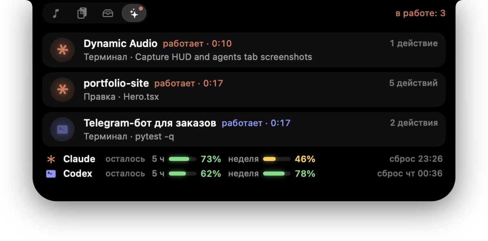
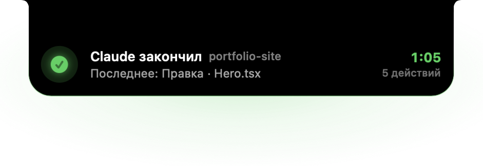
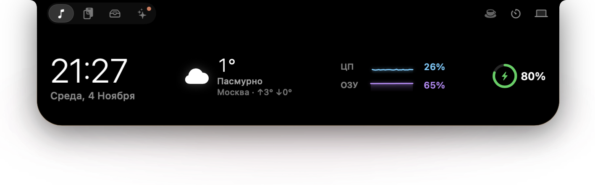
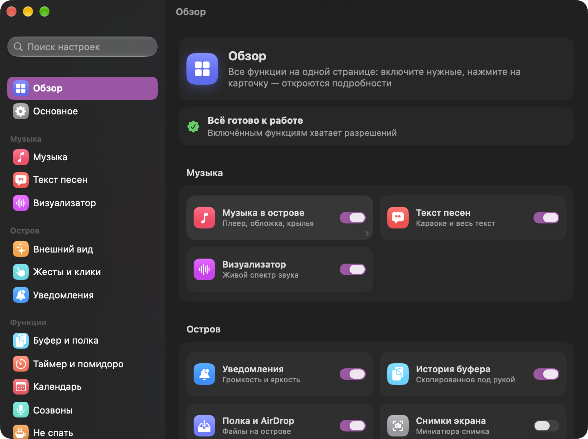

<p align="center">
  
</p>

<p align="center">
  <a href="README.md">English</a> · <b>Русский</b>
</p>

<p align="center">
  <a href="https://github.com/5DHelLD5/dynamic-audio-releases/releases/latest"></a>
  
  
  <a href="https://github.com/5DHelLD5/dynamic-audio-releases/releases"></a>
</p>

<p align="center">
  <b>Dynamic Audio</b> превращает вырез MacBook в живой остров, как на iPhone.<br>
  Он показывает музыку и её спектр, громкость и яркость, батарею и наушники,<br>
  а ещё работу Claude Code и Codex, погоду, таймеры и историю буфера обмена.
</p>

<p align="center">
  <a href="https://github.com/5DHelLD5/dynamic-audio-releases/releases/latest"></a>
</p>

<p align="center">
  <a href="https://web.tribute.tg/d/TQG"></a>
</p>

<p align="center">
  <a href="#-что-умеет">Возможности</a> ·
  <a href="#-установка">Установка</a> ·
  <a href="#-если-приложение-не-открывается">Не открывается?</a> ·
  <a href="#-разрешения">Разрешения</a> ·
  <a href="#-приватность">Приватность</a> ·
  <a href="#-вопросы">Вопросы</a> ·
  <a href="#-документы">Документы</a> ·
  <a href="#-поддержать-автора">Поддержать</a>
</p>

---

## ✨ Что умеет

### 🎵 Музыка
- Обложка и **живой спектр** звука прямо у выреза. 23 стиля визуализатора: полосы, волна, неон, капли, горы, кардиограмма и другие.
- **Текст песни** синхронно с музыкой: строка под вырезом, караоке или весь текст. Тексты берутся из Яндекс Музыки, LRCLIB и NetEase.
- Развёрнутый плеер: перемотка, громкость, «нравится», AirPlay, таймер сна с плавным затуханием.
- Работает с любым плеером, который виден в «Пункте управления» macOS: Яндекс Музыка, Apple Music, Spotify, браузер.

### 🔔 Уведомления, которые хочется рассматривать
Громкость и яркость со шкалой, процентами и свечением. Батарея и зарядка, AirPods с зарядом каждого наушника, Caps Lock, раскладка, «Скопировано» и «Вставлено», снимки экрана.

<p align="center">
  
  
</p>

### ✳️ Claude Code и Codex
Пока ИИ-агент работает, остров показывает, над чем именно: «Правка · Hero.tsx» или «Терминал · pytest». Когда агент закончил или ждёт ответа, всплывает карточка со звуком. Там же видно, **сколько осталось лимитов** подписки на 5 часов и на неделю.

<p align="center">
  
</p>
<p align="center">
  
</p>

### 🌤 Когда ничего не играет
Часы и дата, погода в вашем городе, загрузка процессора и памяти с графиком, заряд батареи и ближайшая встреча из календаря.

<p align="center">
  
</p>

### 🧰 И ещё
| | |
|---|---|
| 📋 **История буфера** | Всё скопированное под рукой, ⌃⌥V открывает выбор, закреплённые записи переживают перезапуск |
| 📥 **Полка и AirDrop** | Перетащите файлы на остров: отправить по AirDrop, сохранить на потом, сжать в ZIP, перевести в PNG/JPEG/HEIC, убрать фон, собрать PDF |
| ⏱ **Таймер и помидоро** | Отсчёт у выреза, перерывы, звук в конце |
| ☕️ **Не спать** | Mac не уснёт, пока это нужно: от 15 минут до 5 часов или пока не выключите |
| 🎙 **Микрофон** | Выключить одной кнопкой или по ⌃⌥M, красный значок, если звонок идёт без звука |
| 🪞 **Зеркало** | Камера в острове, чтобы проверить себя перед созвоном |
| 📅 **Встречи** | Напоминание о созвоне с кнопкой «Подключиться» |
| 💎 **Динамическое стекло** | У выреза остров чёрный, ниже — Liquid Glass |

### ⚙️ Понятные настройки
Все функции собраны на одной странице: включите нужные, а клик по карточке откроет подробности. У каждой функции свой переключатель.

<p align="center">
  
</p>

---

## 📦 Установка

1. Скачайте `Dynamic-Audio-X.Y.zip` из [последнего релиза](https://github.com/5DHelLD5/dynamic-audio-releases/releases/latest).
2. Распакуйте архив и перетащите **Dynamic Audio.app** в папку **«Программы»**.
3. Откройте приложение. При первом запуске macOS, скорее всего, его заблокирует. Что делать, написано в разделе [ниже](#-если-приложение-не-открывается).
4. Откроется помощник первой настройки: отметьте нужные функции, выберите внешний вид и выдайте только те разрешения, которые им нужны. Пройти его заново можно в «Настройки → О программе».

> [!TIP]
> Обновления приходят сами: Dynamic Audio проверяет новые версии и ставит их в один клик («Настройки → О программе» или меню значка в строке меню). Обновление ставится, только если его подпись совпадает с подписью разработчика.

---

## 🛠 Если приложение не открывается

Dynamic Audio подписан сертификатом разработчика, но не прошёл нотаризацию Apple (для неё нужен платный аккаунт разработчика). Поэтому macOS по-разному не даёт открыть скачанное из интернета приложение. Всё лечится за минуту.

<details open>
<summary><b>«Приложение “Dynamic Audio” повреждено, и его не удаётся открыть»</b></summary>

<br>

Приложение не повреждено: так macOS называет программы из интернета без нотаризации. Откройте **Терминал** («Программы → Утилиты → Терминал»), вставьте команду и нажмите Return:

```bash
xattr -cr "/Applications/Dynamic Audio.app"
```

Команда снимает с приложения отметку «скачано из интернета». После неё приложение откроется обычным двойным кликом.

</details>

<details>
<summary><b>«Не удаётся открыть, так как Apple не может проверить его на наличие вредоносного ПО»</b></summary>

<br>

1. Нажмите «Готово» в этом окне.
2. Откройте **Системные настройки → Конфиденциальность и безопасность**.
3. Пролистайте вниз до строки про Dynamic Audio и нажмите **«Всё равно открыть»**, затем подтвердите паролем.

Если кнопки нет, используйте команду из пункта выше: она решает и эту проблему.

</details>

<details>
<summary><b>Приложение запустилось, но острова не видно</b></summary>

<br>

- Посмотрите на строку меню: если там есть значок звуковой волны, приложение работает. Клик по нему открывает панель, правый клик — меню.
- На Mac без выреза и на внешнем мониторе включите **«Настройки → Основное → Экраны без выреза»**.
- В полноэкранных приложениях остров прячется. Это тоже меняется в «Основном».
- Если ничего не помогло, запустите приложение из Терминала и посмотрите сообщения об ошибках:

```bash
"/Applications/Dynamic Audio.app/Contents/MacOS/Dynamic Audio"
```

</details>

<details>
<summary><b>Визуализатор стоит на месте или рисует «демо»</b></summary>

<br>

Нужно разрешение **«Запись системного звука»**: «Настройки → Разрешения → Разрешить». Если доступ в системных настройках включён, а звук всё равно не виден, в «Системные настройки → Конфиденциальность и безопасность» найдите раздел записи экрана и системного звука, удалите оттуда Dynamic Audio кнопкой «−» и выдайте разрешение заново в «Настройки → Разрешения».

</details>

<details>
<summary><b>Нет «Скопировано»/«Вставлено», не работает вставка из истории</b></summary>

<br>

Нужен **универсальный доступ**: «Системные настройки → Конфиденциальность и безопасность → Универсальный доступ» → включите Dynamic Audio.

Если переключатель уже включён, а приложение пишет, что доступа нет, macOS помнит старую подпись приложения. В Dynamic Audio откройте «Настройки → Разрешения → **Сбросить универсальный доступ**», а потом включите Dynamic Audio в списке ещё раз.

</details>

<details>
<summary><b>Не видно музыку из плеера</b></summary>

<br>

Остров показывает то, что macOS знает о текущей музыке. Проверьте, видна ли она в «Пункте управления» (значок ▶︎ в строке меню). Если там пусто, плеер не сообщает системе о музыке. Если в «Настройки → Музыка» задан список скрытых приложений, плеера в нём быть не должно.

</details>

<details>
<summary><b>Как удалить полностью</b></summary>

<br>

Если подключали Claude Code, сначала нажмите «Настройки → Claude и Codex → **Отключить…**»: это уберёт хуки из `~/.claude/settings.json`.

Затем нажмите «Настройки → Основное → **Сбросить все настройки…**». Это удалит настройки, вход в Яндекс Музыку, закреплённое в буфере, копии файлов с полки, статистику прослушивания и кеш. Программа перезапустится чистой: закройте её через меню в строке меню и перенесите из «Программ» в Корзину.

</details>

---

## 🔐 Разрешения

Разрешение нужно, только если включена функция, которая им пользуется. Остров попросит его сам, а в «Настройки → Разрешения» видно, что выдано и зачем.

| Разрешение | Для чего | Когда спросит |
|---|---|---|
| 🎧 **Запись системного звука** | Живой визуализатор: спектр считается из звука Mac | При первом запуске визуализатора |
| ♿️ **Универсальный доступ** | «Скопировано» и «Вставлено», вставка из истории, вырезание файлов в Finder | Когда включаете эти функции |
| 📅 **Календарь** | Напоминания о встречах | Когда включаете «Встречи» |
| 📷 **Камера** | «Зеркало» перед созвоном | При первом открытии «Зеркала» |
| 🎛 **Управление «Музыкой»** | Кнопка «Нравится» для Apple Music | При первом нажатии |

Без разрешений работают: музыка в острове, громкость и яркость, батарея, Caps Lock, раскладка, история буфера, таймеры, погода, Claude и Codex.

---

## 🛡 Приватность

- Никакой аналитики и рекламы, данные никуда не отправляются.
- Звук, камера, календарь и буфер обмена обрабатываются только на вашем Mac.
- В сеть уходят только запросы, без которых функция невозможна:
  - **тексты песен**: название трека в Яндекс Музыку, LRCLIB или NetEase;
  - **погода**: только название города в Open-Meteo, без вашего местоположения;
  - **обновления**: проверка новой версии на GitHub.
- Claude Code сообщает о себе через локальный сокет, доступный только вашей учётной записи. Codex — через журналы сессий на диске, которые Dynamic Audio только читает.

---

## 💛 Поддержать автора

Dynamic Audio бесплатный: без рекламы, регистрации и пробного периода. Если он вам пригодился, автора можно поддержать любой суммой. Поддержка добровольная и ничего не открывает.

Донаты принимает [Tribute](https://web.tribute.tg/d/TQG): можно заплатить картой в браузере, указав только почту, или прямо в Telegram.

Звезда репозиторию тоже помогает: так программу находят другие.

---

## ❓ Вопросы

<details>
<summary><b>Работает ли без выреза?</b></summary>
<br>
Да. На Mac без выреза и на внешних мониторах остров становится стеклянной капсулой у верхнего края экрана.
</details>

<details>
<summary><b>Сильно ли нагружает Mac?</b></summary>
<br>
В покое — меньше 1% одного ядра. С живым визуализатором — около 5–7%: анимации считает Core Animation, а не приложение. От батареи можно включить экономию энергии: визуализатор перейдёт на 30 кадров в секунду.
</details>

<details>
<summary><b>Почему Apple Silicon?</b></summary>
<br>
Остров рассчитан на MacBook с вырезом, а такие бывают только на Apple Silicon. Нужна macOS 27 или новее.
</details>

<details>
<summary><b>Где сообщить об ошибке или предложить идею?</b></summary>
<br>
Откройте <a href="https://github.com/5DHelLD5/dynamic-audio-releases/issues/new/choose">новый issue</a> и выберите форму: «Ошибка» или «Идея». Для ошибки укажите версию macOS и Dynamic Audio («Настройки → О программе»). Об уязвимостях пишите приватно, как описано в <a href="SECURITY.md">SECURITY.md</a>.
</details>

---

## 📚 Документы

- [Лицензия](LICENSE.md) и [товарные знаки](TRADEMARKS.md)
- [Приватность](PRIVACY.md): что уходит в сеть и когда
- [Помощь](SUPPORT.md): куда писать об ошибках и идеях
- [Безопасность](SECURITY.md): как приватно сообщить об уязвимости

Документы написаны на английском.

---

<p align="center">
  <sub>© 2026 5DHelLD5. Программа бесплатная, условия в <a href="LICENSE.md">лицензии</a>. Здесь только готовые сборки, исходный код закрыт.</sub><br>
  <sub>Apple, Mac, MacBook и macOS — товарные знаки Apple Inc., Claude принадлежит Anthropic, Codex — OpenAI. Dynamic Audio с ними не связан.</sub>
</p>
